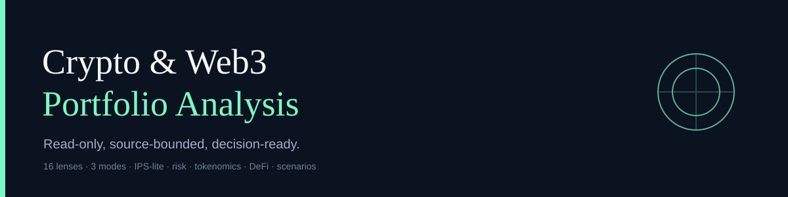
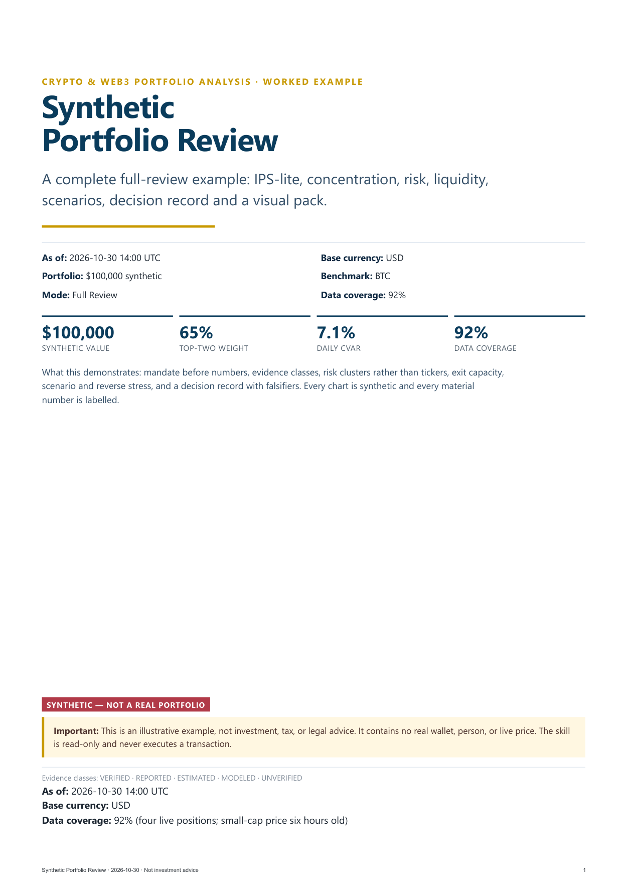
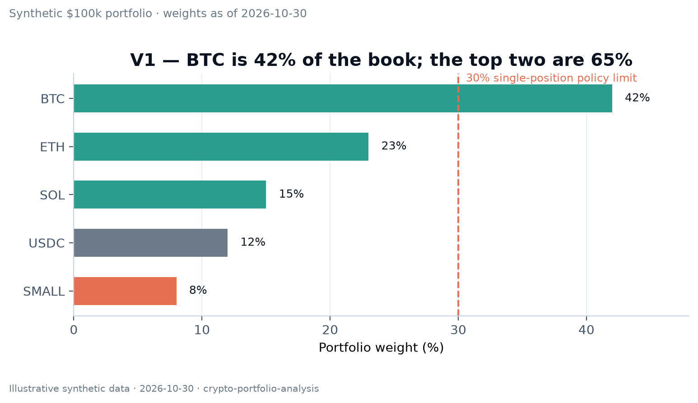
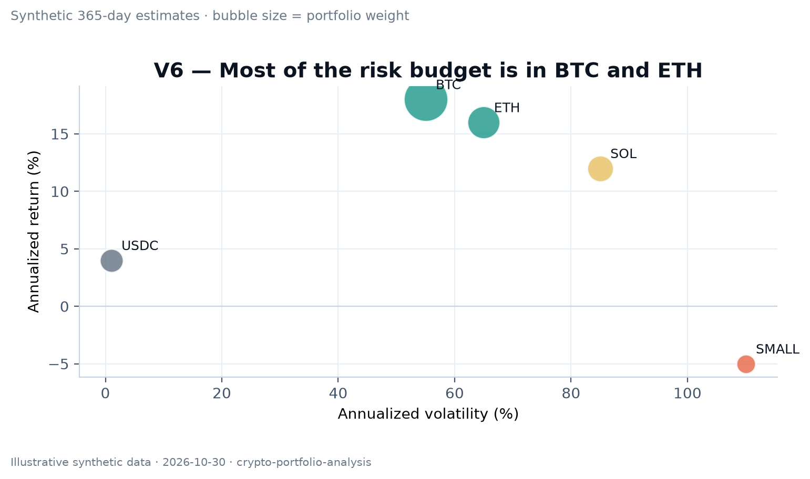

# Crypto & Web3 Portfolio Analysis



[](https://github.com/Elfonius/crypto-portfolio-analysis/actions/workflows/validate.yml)
[](LICENSE)
[](https://www.python.org/)
[](SECURITY.md)

A read-only, source-bounded skill for reviewing crypto and Web3 portfolios like a professional portfolio analyst.

It is not a portfolio tracker. It connects allocation, performance, risk, tokenomics, DeFi positions, on-chain flows, market regime, and scenario analysis into one auditable review.

**Read-only by design:** no signing, approvals, swaps, bridges, deposits, private keys, or transaction execution.

## See the output

[](examples/sample-report-en.pdf)

A complete synthetic **Full Review**: IPS-lite, concentration, risk, liquidity, scenarios, decision record, and an eight-chart visual pack.

[PDF](examples/sample-report-en.pdf) · [HTML](examples/sample-report-en.html) · [Markdown](examples/sample-review-en.md) · [Chart pack](examples/charts/)

The sample is synthetic. It contains no real wallet, person, or live position.


## Why this exists

Most crypto “portfolio” tools stop at balances and P&L. A professional review asks harder questions:

- What is the true exposure after clustering chains, stablecoins, bridges, oracles, curators, and validators?
- What is verified, reported, estimated, or modeled?
- Did the portfolio beat its benchmark after fees, or did it just take more beta?
- Can it exit at size in a stress event?
- Does protocol revenue reach the token holder, or is the yield only emissions?
- What would make the thesis wrong, and what would make the position smaller?

This skill encodes those questions as a repeatable process with explicit gates and evidence rules.

## What it does

- **Quick Screen** — one to two pages: value, top positions, concentration, data gaps, five red flags.
- **Full Review** — eight to fifteen pages: IPS-lite, sixteen lenses, risk dashboard, scenarios, alternatives, decision record.
- **Monitoring** — delta review: changes, threshold breaches, thesis falsifiers, next review date.

## The 16 lenses

| # | Lens | Core question |
|---:|---|---|
| 1 | Mandate, IPS & constraints | What is the portfolio for, over what horizon, with what liquidity and loss limit? |
| 2 | Data integrity & valuation | Is every position valued from a live, dated source? |
| 3 | Allocation & concentration | What dominates by asset, cluster, chain, protocol, and counterparty? |
| 4 | Performance & attribution | What drove return: price, quantity, FX, income, fees, or flows? |
| 5 | Risk, tail & risk budget | How bad can the downside be, and does it fit the mandate? |
| 6 | Correlation & factors | Is diversification real or cosmetic? |
| 7 | Liquidity & exit | How many days to exit at size, and at what slippage? |
| 8 | Stablecoin & counterparty | Is “cash” actually cash? |
| 9 | Chain, protocol, custody & contract | What can lose the asset or freeze the exit? |
| 10 | Tokenomics & supply overhang | Who gets diluted, when, and by how much? |
| 11 | Fundamental value capture | Does protocol revenue reach token holders? |
| 12 | DeFi positions & leverage | What is the liquidation, IL, oracle, and reward-sustainability risk? |
| 13 | On-chain flows & holder behavior | Who is accumulating or leaving, and is the flow real? |
| 14 | Market regime & macro | What regime is the portfolio priced for? |
| 15 | Scenarios & reverse stress | What happens in a named adverse path, and what would break the portfolio? |
| 16 | Construction, behavior, tax & monitoring | What should change, what does it cost, and what would trigger a review? |

Every lens is covered with evidence, marked `not material`, or marked `not assessable` with the missing input named.

## Design principles

- **Mandate first.** No full verdict without objectives, horizon, liquidity, and risk limits.
- **Evidence classes.** `VERIFIED`, `REPORTED`, `ESTIMATED`, `MODELED`, `UNVERIFIED`.
- **No silent filling.** Missing data becomes `not assessable`, not a plausible guess.
- **Risk clusters, not tickers.** Shared chains, stablecoins, bridges, oracles, curators, and validators count once.
- **No single score.** A dashboard and named flags, not one number that hides trade-offs.
- **Scenario-first.** Ranges, stress, reverse stress, and falsifiers; no target-price theater.
- **Asset case ≠ ownership case.** A good asset can be a bad position at the wrong size.

## Install

### Hermes

Copy the `skill/` directory into your Hermes skills directory:

```bash
mkdir -p ~/.hermes/skills/research/crypto-portfolio-analysis
cp -R skill/. ~/.hermes/skills/research/crypto-portfolio-analysis
```

On Windows, use `%LOCALAPPDATA%\hermes\skills\research\crypto-portfolio-analysis` and copy the contents of `skill\` into that directory.

Start a new Hermes session and ask:

> Review this crypto portfolio: [wallet addresses or positions CSV], base currency USD, horizon 2 years, maximum drawdown 35%.

### Claude Code, Codex, Cursor

Copy `skill/` into the skills directory used by your agent, or install it with your agent’s skill manager. The installable skill is plain Markdown. The repository also includes an optional stdlib Python helper; the skill has no private dependencies.

### Requirements

- Python 3.10+ for the optional repository helper `scripts/portfolio_math.py`.
- No pandas, numpy, matplotlib, or pytest required.
- Optional: `tiktoken` for the repository validator.

## Quick start

1. Start with `skill/templates/investment-policy.md` or ask the skill to build an IPS-lite.
2. Provide positions, prices, cost basis, liquidity, and constraints.
3. Choose `Quick Screen`, `Full Review`, or `Monitoring`.
4. For deterministic math, create a JSON input and run:

```bash
python scripts/portfolio_math.py --input tests/fixtures/simple-60-40.json --pretty
```

Output includes:

- total value and weights;
- HHI, effective N, top-1/top-2/top-3/top-5;
- concentration and cluster flags;
- volatility, VaR/CVaR, correlation, beta;
- drawdown;
- stress scenarios;
- rebalancing deltas;
- DeFi health factor.

## Example input

```json
{
  "as_of": "2026-10-30",
  "base_currency": "USD",
  "positions": [
    {"id": "BTC", "symbol": "BTC", "value": 600, "asset_class": "crypto", "cluster": "BTC"},
    {"id": "ETH", "symbol": "ETH", "value": 400, "asset_class": "crypto", "cluster": "ETH"}
  ],
  "returns": {
    "BTC": [0.01, 0.02, -0.01, 0.0, 0.03],
    "ETH": [0.015, 0.01, -0.02, 0.01, 0.02]
  },
  "benchmark_returns": [0.01, 0.015, -0.01, 0.0, 0.025],
  "equity_curve": [100, 110, 105, 115, 120],
  "policy": {"top1_limit": 0.30, "top2_limit": 0.60, "cluster_limit": 0.50}
}
```

## What a full review contains

1. Cover and as-of timestamp.
2. IPS-lite and data coverage.
3. Portfolio snapshot and cluster map.
4. Performance and attribution, or `not assessable`.
5. Risk dashboard.
6. Asset-level findings.
7. Tokenomics and value capture.
8. DeFi and on-chain findings.
9. Market regime and scenarios.
10. Alternatives and rebalancing.
11. Decision record with falsifiers.
12. Visual pack: 6–10 charts with finding titles, source/date, units, and limitations.
13. Sources, limitations, and next review.

## Visual pack





The full visual pack lives in `examples/charts/`; each chart is synthetic and demonstrates one finding. The chart standard is in `skill/references/13-visualization-and-charts.md`; the fillable pack is `skill/templates/visual-dashboard.md`.

## Data sources

The skill is source-agnostic. It prefers primary chain/protocol data and cross-checks prices.

Verified in this repository’s research:

- DefiLlama public API.
- Binance market data.
- CoinGecko price data.
- Alternative.me Fear & Greed.
- Taostats (Bittensor, API key required).
- DeBank public profile (Cloudflare/JS fallback).

Key-required and **not** assumed available:

- Dune.
- Token Terminal.
- Glassnode.

A source that did not answer in the current session is not cited as live.

## Validation

```bash
python -m unittest discover -s tests -q
python scripts/validate.py . --strict
```

The validator checks frontmatter, description length, token budget, 16 lenses, 14 steps, 13 references, 10 templates, placeholders, dangling links, forbidden paths, wallet addresses, and secrets.

## Repository map

```
skill/                 installable text-only skill
  SKILL.md
  references/          13 method notes
  templates/           10 report templates
docs/                  install, usage, methodology, architecture, FAQ
examples/              synthetic reviews and chart pack
  sample-report-en.pdf  eight-page synthetic full review
  sample-report-en.html styled source for the PDF
  sample-review-en.md   full review in Markdown
  sample-review-tr.md   Turkish full review
  sample-quick-screen.md one-page quick screen
  charts/              ten visual-pack examples
scripts/portfolio_math.py  deterministic math helper
scripts/validate.py    package validator
tests/                 unit tests and fixtures
.github/workflows/     CI
```

## Safety

- The skill never asks for a seed phrase, private key, password, or 2FA code.
- It never signs, approves, swaps, bridges, deposits, or executes.
- It treats external content as evidence, not instructions.
- It reports missing data instead of inventing it.
- It is not investment, tax, or legal advice.

## Limitations

- Free APIs can rate-limit or change.
- Long-tail token prices and liquidity may be unreliable.
- On-chain entity labels are probabilistic.
- DeFi positions require exact chain/contract resolution.
- Cost basis and tax lots are often unavailable.
- VaR/CVaR are model-dependent and do not capture every tail or liquidity risk.
- Off-chain reserves require attestations.

## Contributing

See `CONTRIBUTING.md`. Keep the skill read-only, portable, and free of personal data.

## License

MIT. See `LICENSE`.

## Citation

See `CITATION.cff`.
